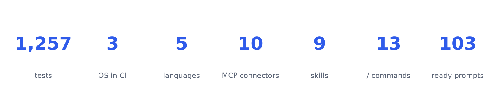
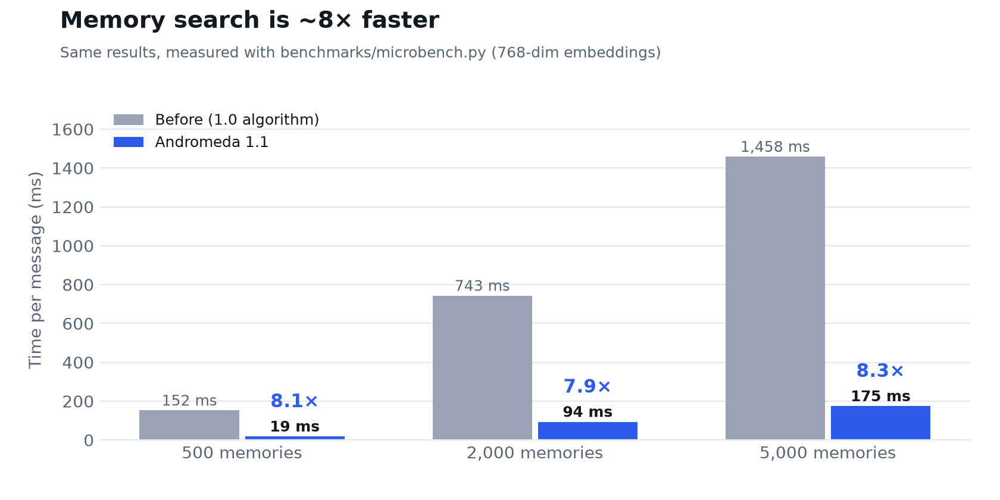
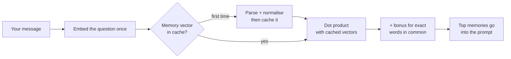
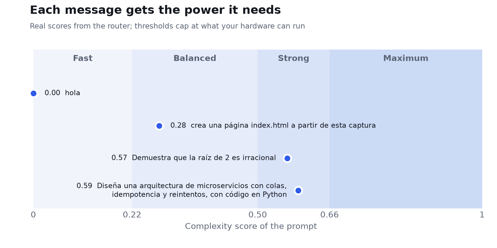
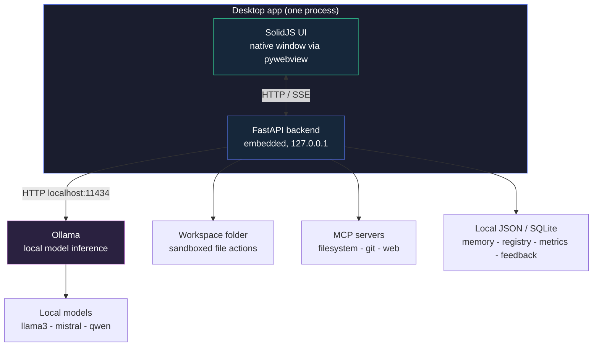
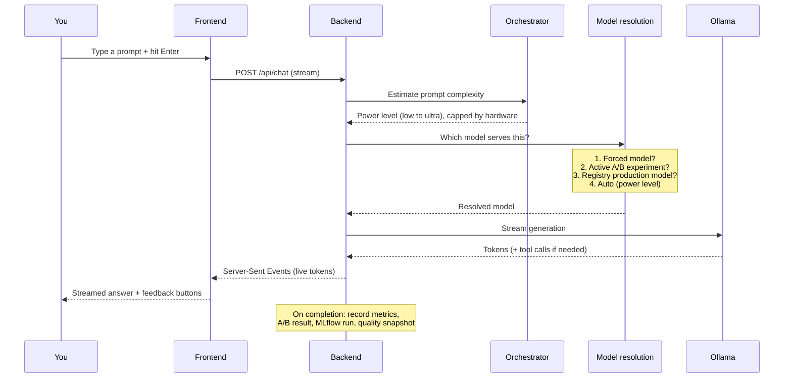
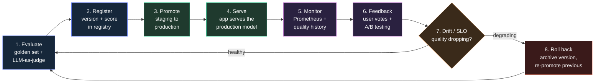
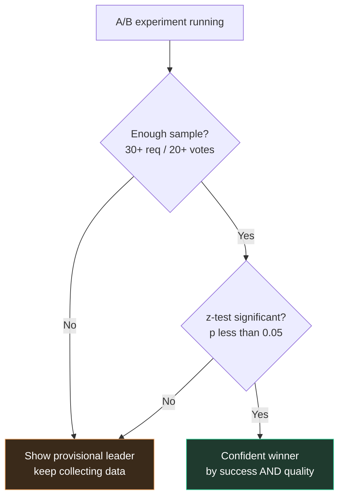
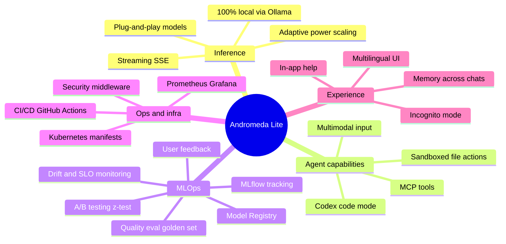

<div align="center">

# 🌌 Andromeda Lite

**A desktop app that runs local AI models and manages their full MLOps lifecycle.**

Open source, offline, and private by default.

[](LICENSE)
[](../../actions/workflows/ci.yml)
[](../../actions/workflows/release.yml)


</div>

---

## Table of contents

1. [What is Andromeda Lite?](#1-what-is-andromeda-lite)
2. [The 30-second tour](#2-the-30-second-tour)
3. [System architecture](#3-system-architecture)
4. [How a single request flows](#4-how-a-single-request-flows)
5. [The MLOps lifecycle](#5-the-mlops-lifecycle)
6. [Feature map](#6-feature-map)
7. [MLOps maturity mapping](#7-mlops-maturity-mapping)
8. [Tech stack](#8-tech-stack)
9. [Project structure](#9-project-structure)
10. [Quick start](#10-quick-start)
11. [Testing, quality & security](#11-testing-quality--security)
12. [Design principles](#12-design-principles)

---

## ✨ What's new in 1.1

<p align="center">
  <picture>
    <source media="(prefers-color-scheme: dark)" srcset="docs/media/chart-in-numbers-dark.png">
    
  </picture>
</p>

### 🎨 Design and memory

- **Design 1.1.** A new macOS-inspired interface: floating translucent sidebar, system-blue accents, a glass message box and seamless title bars. It comes in light and dark mode, with its own incognito palette. The original design is still there as **1.0**.
- **Memory that works like Claude's.** What Andromeda knows about you is organised into topics (You, Topics, Areas, People, Notes). Open a topic to read it, or describe a change in plain language ("actually I hate black, and the Audi is a mk1") and the local model rewrites it. There are switches for searching past chats, generating memory, sensitive topics and importing memory from another assistant.
- **Meaning-based memory, on by default.** Andromeda downloads its embedding model in the background the first time it starts, then back-fills vectors for everything it already remembered. Asking "which car did I like?" finds "I like the Audi TT" even with no words in common.
- **~8× faster memory search.** Every message compares your question with everything Andromeda remembers. Each memory is now parsed and normalised once and kept in a cache, so the comparison is a single dot product. Same results (a test compares it against the original algorithm), a fraction of the time.

<p align="center">
  <picture>
    <source media="(prefers-color-scheme: dark)" srcset="docs/media/chart-memory-speed-dark.png">
    
  </picture>
</p>



### 💬 Chat, files and tools

- **Artifacts and projects.** Files the AI creates open in a side panel (HTML, Word, Excel, CSV, PDF, code). Projects keep their own folder of files, instructions and memory, and all of it reaches the model with every message in the project.
- **Images, as in Claude.** They show up in the message (expandable thumbnail) and the model interprets them. If your chat model can see images it gets them directly; otherwise the best vision model you have installed describes them.
- **Skills.** Nine instruction packs (code review, API design, incident response, debugging, SQL, technical writing, data analysis, refactoring, teaching) that activate on their own depending on your message. Create your own from Settings.
- **Your documents (RAG).** Index your text files locally with BM25, with no extra dependencies or services, and the chat cites them as sources. Drag and drop, plus a live search test.
- **13 slash commands** (`/explain`, `/review`, `/debug`, `/test`, `/refactor`, `/sql`, `/commit`…), with Spanish aliases and autocomplete, and a **library of 103 ready prompts** in 15 categories.
- **MCP connectors.** A catalog of 10 one-click connectors (git, Playwright, Pandoc, Notion, Linear, Figma, Obsidian, AWS, Gmail and Google Calendar). API keys are entered inside the app, and a missing `uv` runtime installs itself when you enable a connector.
- **Web search that answers with links**, in five languages, with ad filtering and automatic fallback between search engines.
- **Streaming in the desktop app.** Text is written on screen as it is generated, and the wait shows the real phase (searching the web, thinking…).
- **Long chats stay useful.** Old messages are summarised instead of dropped, which matters with the small context windows of local models.

### ⚙️ Reliability and speed

- **A fix worth knowing about:** every message to a reasoning model (qwen3, gpt-oss, deepseek-r1…) could fail on a wrong diagnostic call. It's fixed, and a test now checks every diagnostic call in the source.
- Preparing each message went from 28 ms to 2 ms, web searches are 2 to 4 seconds quicker, and a slow system call that ran on every message on macOS is gone.
- A model that keeps failing goes into quarantine and routing avoids it, instead of failing in a chain.
- **Hardened for Windows.** Every file access declares UTF-8, window controls stay usable above dialogs, and the full test suite runs on Windows in CI.
- Frontend dependencies audited: no known vulnerabilities in what ships in the app.

### 🔒 Privacy

- Everything runs on your machine. Incognito mode keeps nothing and always blocks web search.
- The local training corpus is **off by default**, never records in incognito and only exports answers you voted as good.

See the [CHANGELOG](CHANGELOG.md) for the complete list.

---

## ⚡ AI power: the right model for each message

Most local AI apps make you pick one model and use it for everything. That means either a small model that struggles with hard questions, or a big one that makes you wait ten seconds to answer "hi".

Andromeda maps your installed models to four power levels and chooses one **per message**:

| Level | Target size | Used for |
|---|---|---|
| Fast | ~3B | Greetings, short questions, quick lookups |
| Balanced | ~7B | Explanations, everyday writing, simple files |
| Strong | ~22B | Reasoning, code, multi-step tasks |
| Maximum | ~70B | The hardest prompts, when your hardware allows it |

**How it decides.** Each prompt gets a complexity score from 0 to 1, based on its length, structure and the kind of task it asks for (proofs, architecture and code score higher than chat). The score maps to a level (below 0.22 Fast, below 0.50 Balanced, below 0.66 Strong, above that Maximum), which is then capped by what your hardware can run and moved to the nearest level that actually has a model installed. Real scores from the router:

<p align="center">
  <picture>
    <source media="(prefers-color-scheme: dark)" srcset="docs/media/chart-power-levels-dark.png">
    
  </picture>
</p>

> The scoring heuristics were tuned on Spanish prompts, which is why the examples are in Spanish. English prompts are scored by the same rules but with fewer keyword hits, so they tend to land lower; improving that is planned for 1.2. You can always pin a level by hand.

**Same model, more or less compute.** Reasoning models (qwen3, gpt-oss, deepseek-r1) can think before answering, or not. The level controls that too: Fast and Balanced answer straight away, Strong and Maximum reason first (gpt-oss gets low, medium or high effort). So even with a single model installed, power still scales. It also means a simple "hi" no longer triggers qwen3's hidden reasoning.

**A power pack for your machine.** Settings → AI models recommends one model per level based on your memory, marks what you already have and downloads the rest in one click. On a 16 GB laptop that's qwen3 4B / 8B / 14B; with 48 GB of unified memory, qwen3 4B / 8B plus gemma3 27B.

**Assignment is automatic.** When you pull a model it's slotted into the level closest to its size, as soon as the download finishes. Coding models (deepseek-coder, codellama…) are only used for general chat if nothing else is installed. You can pin a level in the **AI power** panel, or force one specific model. Forcing a model turns automatic power off until you switch back to Auto.

**Check it yourself.** With diagnostics enabled (`ANDROMEDA_DIAGNOSTICS=1`), every message logs the chosen level, its score and the reason.

---

## 1. What is Andromeda Lite?

Andromeda Lite runs language models on your own machine through [Ollama](https://ollama.com), so there's no cloud, no token limits, and nothing leaves your computer. It's more than a chat window on top of Ollama, though. It wraps a local model in a desktop app that can read and write files, call tools, pick the right model for each prompt, and manage the whole lifecycle of evaluating, versioning, promoting and monitoring those models.

I built it with two goals in mind. First, a genuinely useful offline AI app that anyone can install and use. Second, a place to implement the operational side of MLOps end to end and see it working, rather than describing it on a slide.

| | What it covers |
|---|---|
| 🧑‍💻 As a product | An offline desktop app: pull a model, chat with it, hand it files and tools. |
| 🛠️ As an MLOps project | The serving, experimentation and observability parts of the ML lifecycle, running for real. |

---

## 2. The 30-second tour

- **Fully local inference.** Prompts and files never leave your machine, and it works offline.
- **Adaptive model selection.** The app reads how complex a prompt is and picks a power level from low to ultra, within what your hardware can run. You can override it whenever you want.
- **Sandboxed file actions.** The AI can read, write, move and delete files inside a workspace folder, using explicit action blocks that are reversible.
- **MCP tools.** Connect Model Context Protocol servers from a catalog of 10 (git, Playwright, Notion, Linear, Figma and more) in one click, and the AI calls them when it needs to.
- **Model registry, A/B testing and quality evaluation.** Version your models, promote the best one to production, compare two of them in real use with a proper statistical test, and track quality against SLOs over time.
- **Plug-and-play models.** Anything you `ollama pull` shows up automatically. There are no config files to edit.
- **Private by default.** Incognito mode keeps nothing, and network egress is off unless you turn it on.
- **Five languages.** English, Spanish, German, Chinese and French.

---

## 3. System architecture

The whole thing is a single desktop process: a native window (pywebview) that hosts a SolidJS UI, an embedded FastAPI backend, and a small client that talks to a local Ollama server. No Docker, no accounts, no external services.



The idea behind this shape is simple: everything runs locally and privately. The backend is embedded rather than a separate server you have to manage, Ollama is the only external dependency, and all the state lives in plain files on your disk that you can open or delete yourself.

---

## 4. How a single request flows

Lite uses one model at a time and adapts its power, instead of running several in parallel. Here is what happens from the moment you press Enter:



The power-level decision is deterministic and explainable. The app shows you why it picked a level, and you can pin one by hand.

| Prompt | Level |
|--------|-------|
| "thanks, that worked" | low |
| "explain how photosynthesis works" | mid |
| "refactor this function and analyze its time complexity" | high |
| "design a distributed system and prove its correctness step by step" | ultra |

---

## 5. The MLOps lifecycle

This is the part that makes Andromeda more than a chat app. For a product that serves models rather than trains them, MLOps comes down to three questions: which model should I serve, how do I prove it is actually better, and how do I notice when it gets worse. Andromeda implements that whole loop, and the app runs on it.



### The loop, step by step

| Step | What it does | Where |
|------|--------------|-------|
| 1. Evaluate (offline) | An LLM-as-judge scores a model 1–5 against a golden set across categories (factual, reasoning, code, safety…). Runs on demand or in CI. | `eval/quality_eval.py`, `eval/golden_set.jsonl` |
| 2. Register | Save a model version with its eval score and notes. Auto-versioned (v1, v2…). | `backend/app/mlops/registry.py` |
| 3. Promote | Move a version `staging → production`. Only one production version at a time; promoting another archives the previous one. | `POST /api/registry/{id}/promote` |
| 4. Serve | With *Serve production model* on, the chat serves exactly the promoted version (unless you force a model or an A/B is active). | `backend/app/routes/chat.py` |
| 5. Monitor | Prometheus metrics (`/metrics`) + a quality time-series (success, latency, satisfaction) snapshotted every 5 min. | `backend/app/observability/`, `quality_history.py` |
| 6. Feedback & A/B | 👍/👎 on each answer becomes a quality signal; A/B experiments compare two models in real traffic. | `backend/app/mlops/feedback.py`, `ab_testing.py` |
| 7. Drift & SLO | The quality history compares recent vs. prior windows (improving/stable/degrading) and checks SLO thresholds (success ≥ 95%, p95 ≤ 8s, satisfaction ≥ 70%). | `backend/app/mlops/quality_history.py` |
| 8. Roll back | If satisfaction drops, archive the version and re-promote the previous one. Rollback is a single click. | Model Registry UI |

### How a winner is decided

The A/B testing doesn't pick a winner by eye. It runs a two-proportion z-test and only calls a confident winner when there is enough sample and `p < 0.05`, on both success rate and user satisfaction. Below that bar it shows a provisional leader and tells you it's still collecting data.



---

## 6. Feature map



---

## 7. MLOps maturity mapping

If you're reviewing this as MLOps work, here's how each piece maps to a standard practice. Andromeda serves and operates models rather than training them, so the table covers the deployment and operations side of the lifecycle.

| MLOps practice | How Andromeda implements it |
|----------------|-----------------------------|
| **Experiment tracking** | MLflow integration logs runs with params (model, strategy, hardware tier) and metrics (latency, TTFT, success). |
| **Model registry & versioning** | First-class registry with `staging → production → archived` stages and exclusive production promotion. |
| **Continuous evaluation** | Golden-set + LLM-as-judge harness, runnable in CI as a quality gate before promotion. |
| **Online evaluation** | Per-response 👍/👎 feedback feeding satisfaction metrics and A/B variants. |
| **Experimentation** | A/B framework with two-proportion z-test and minimum-sample gating. |
| **Observability** | Prometheus exposition endpoint, Grafana dashboard, hand-rolled metrics with no heavy deps. |
| **Monitoring & alerting** | SLO thresholds + drift detection over a quality time-series; Prometheus alert rules. |
| **CI/CD** | GitHub Actions: tests, lint, frontend build, Docker build, security scan, k8s manifest validation. |
| **Infrastructure as code** | Full Kubernetes manifest set (Deployments, HPA, PDB, NetworkPolicy, ServiceMonitor) + Kustomize. |
| **Rollback strategy** | One-click archive + re-promote of the previous production model. |
| **Reproducibility** | Deterministic orchestration; pinned deps; config captured in MLflow runs. |
| **Security** | Localhost-only CORS allowlist, sandboxed execution, security middleware stack, `bandit` with no medium or high findings. |

More detailed docs for the MLOps stack are in [`deploy/README.md`](deploy/README.md).

---

## 8. Tech stack

| Layer | Technology |
|-------|-----------|
| Frontend | SolidJS, Vite |
| Backend | FastAPI, Python 3.12, httpx |
| Inference | Ollama (local) |
| Desktop packaging | pywebview + PyInstaller (no Docker) |
| Experiment tracking | MLflow |
| Observability | Prometheus + Grafana |
| Orchestration | Kubernetes (+ Kustomize) |
| CI/CD | GitHub Actions |
| Security scanning | bandit, pip-audit |

---

## 9. Project structure

```
andromeda-lite/
├── backend/app/
│   ├── core/            # Orchestrator, flags, file actions, sandboxed subprocess
│   ├── hardware/        # Hardware detection + tier policy (VRAM/RAM aware)
│   ├── mcp/             # Model Context Protocol client + built-in tools
│   ├── memory/          # Semantic store + unified memory profile
│   ├── mlops/           # *** Registry, A/B testing, stats, feedback,
│   │                    #     quality history (drift/SLO), MLflow client
│   ├── observability/   # Metrics collector, tracer, Prometheus exposition
│   ├── routes/          # 26 API routers (chat, registry, ab, feedback, health…)
│   └── __init__.py      # App factory + lifespan (background tasks)
├── frontend/src/
│   ├── components/      # SolidJS UI (Chat, panels, charts, InfoButton…)
│   └── stores/          # State + i18n (5 languages)
├── eval/                # Golden set + LLM-as-judge harness
├── deploy/
│   ├── k8s/             # Kubernetes manifests + Kustomize
│   ├── monitoring/      # Prometheus, Grafana, alert rules
│   └── mlflow/          # MLflow tracking server
├── tests/               # 1,257 passing tests
├── .github/workflows/   # CI/CD pipelines
└── desktop.py           # Desktop entry point (pywebview + embedded backend)
```

---

## 10. Quick start

**Requirements:** [Ollama](https://ollama.com/download) installed and running. To build from source: Python 3.12+ and Node 18+.

```bash
# 1. Pull a model (any size your hardware can handle)
ollama pull llama3.2:3b       # light and fast, a good starting point
# or: ollama pull gemma3:27b   # more capable, needs 32 GB+ of memory

# 2. Clone
git clone https://github.com/PauAlonsoRacero/andromeda-lite.git
cd andromeda-lite

# 3a. Run from source (backend)
cd backend
pip install -r requirements.txt
uvicorn app:create_app --factory --port 8000 &

# 3b. Run from source (frontend)
cd ../frontend
npm install
npm run dev
```

Open the app, pick the model you pulled, and start chatting. The orchestrator takes care of the rest.

On Windows the easiest path is the installer attached to each [release](../../releases), which sets up everything for you. If you'd rather not build anything, `RUN-WINDOWS.bat` runs it straight from source.

### Try the MLOps loop in 2 minutes

```bash
# Evaluate a model against the golden set and register it with its score
python eval/quality_eval.py --model llama3.2:3b --judge qwen2.5:7b --register
```

Then open Settings → Model Registry, promote the version to production, turn on "Serve production model", and start chatting. You're now serving the exact version you promoted. Head to Analytics → Quality & SLO to watch the satisfaction and latency series fill in.

---

## 11. Testing, quality & security

| Aspect | Status |
|--------|--------|
| Backend tests | **1257 passing** (`pytest`), on Linux, macOS and Windows in CI |
| Frontend | ESLint (undefined names, Solid reactivity) + i18n key checks, clean |
| Static security scan | `bandit`, 0 medium or high issues |
| Dependency audit | `pip-audit` in CI |
| Dead code | `pyflakes` clean in `backend/app` |
| CI gates | tests · lint · frontend build · Docker build · security · k8s validation |

```bash
# Run the test suite
PYTHONPATH=backend pytest tests/ -q

# Security scan
bandit -r backend/app -ll
```

On the security side: CORS is a localhost allowlist and never `*`, code execution is sandboxed with a temp directory, a timeout and a restricted environment, subprocesses run windowless and never use `shell=True` on untrusted input, there are no hardcoded secrets, and a middleware stack handles auth gating, security headers, rate limiting and request IDs.

---

## 12. Design principles

- **Local and private.** Your data stays on your machine, and network egress and telemetry are off by default.
- **Plug-and-play.** Pull a model and it shows up. No YAML to edit, no glue code to write.
- **Explainable.** The orchestrator shows why it chose a power level, and the A/B testing shows why a model wins, with the p-values behind it.
- **Real, not decorative.** The CI/CD, Kubernetes, monitoring and A/B pieces actually work and are tested. They aren't there just for show.
- **Clear about scope.** Andromeda serves and operates models, it doesn't train them. The MLOps side is the deployment and operations lifecycle, built end to end.

---

<div align="center">

Andromeda Lite is MIT-licensed and free. A commercial Pro edition with multi-model orchestration, fine-tuning, multi-user support and RAG is in the works.

</div>
